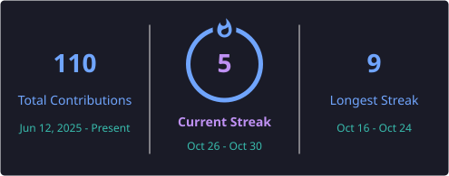

<!-- SUGAN-24 | MIDNIGHT AURORA DEVELOPER PROFILE -->

  
   
  
    
  
  
  

---

### ABOUT ME

I’m a Computer Science & Engineering student who enjoys turning ideas into working software.

**My focus:** Java · Full-stack development · AI applications · Problem solving

*Curious mind. Consistent practice. Projects that keep getting better.*

 

<h2 align="center">✦ EDUCATION</h2>

| **QUALIFICATION** | **INSTITUTION** | **YEAR** | **RESULT** |
|:---|:---|:---:|:---:|
| B.E. Computer Science and Engineering | V.S.B. Engineering College, Karur · Anna University, Chennai | 2023–2027 | CGPA: 7.7 |
| HSC / Class XII | Malar Matriculation Higher Secondary School, Namakkal | 2021–2023 | 75% |
| SSLC / Class X | R.N. Oxford Matriculation School, Namakkal | 2021 | All Pass |

<h2 align="center">✦ TECH STACK</h2>

  

| **CORE** | **BUILDING WITH** | **TOOLS** |
|:---:|:---:|:---:|
| Java · OOP · DSA | React · Node.js · Express | Git · GitHub · VS Code |
| Problem solving | HTML · CSS · JavaScript | MongoDB · MySQL |

<h2 align="center">✦ FEATURED PROJECTS</h2>

<table>
  <tr>
    <td width="50%" valign="top">
      <h3>✧ DevMentor AI</h3>
      
An AI-assisted coding mentor concept for project-based learning, debugging support, and interview preparation.

      
React · Vite · Node.js · Express

      
    </td>
    <td width="50%" valign="top">
      <h3>✧ EduWiz AI</h3>
      
An educational chatbot that adapts explanations to Basic, Intermediate, and Advanced learning levels.

      
React · Node.js · Express · Gemini API

      
    </td>
  </tr>
  <tr>
    <td colspan="2" valign="top">
      <h3>✧ Java Practice</h3>
      
A growing collection of Java exercises to strengthen programming fundamentals and problem-solving skills.

      
Java · Core programming · Practice

      
    </td>
  </tr>
</table>

<h2 align="center">✦ CONTRIBUTION TRAIL</h2>

  <picture>
    <source media="(prefers-color-scheme: dark)" srcset="https://raw.githubusercontent.com/SUGAN-24/SUGAN-24/output/github-contribution-grid-snake-dark.svg" />
    <source media="(prefers-color-scheme: light)" srcset="https://raw.githubusercontent.com/SUGAN-24/SUGAN-24/output/github-contribution-grid-snake.svg" />
    
  </picture>
  
Every contribution leaves a trail. Keep building, and let the snake chase the squares.

<h2 align="center">✦ GITHUB ACTIVITY & ANALYTICS</h2>

<table>
  <tr>
    <td width="50%" align="center" valign="top">
      <b>✦ CONTRIBUTION BREAKDOWN</b> 
      
    </td>
    <td width="50%" align="center" valign="top">
      <b>✦ GITHUB STATS</b> 
      
    </td>
  </tr>
  <tr>
    <td colspan="2" align="center" valign="top">
      <b>✦ CONTRIBUTION STREAK</b> 
      Consistency over time · Every commit counts  
      
    </td>
  </tr>
</table>

<h2 align="center">✦ LEETCODE DASHBOARD</h2>

  

    
  
    
  <b>Practice. Learn. Improve. Repeat. ✦</b>

<h2 align="center">✦ CERTIFICATIONS</h2>

| **CERTIFICATION** | **ISSUED BY** | **DETAILS** |
|:---|:---|:---|
| Programming in Java | NPTEL · IIT / Ministry of Education | 12-week course · 66% |
| Java Foundation Course | Infosys Springboard | |

<h2 align="center">✦ CURRENTLY LEVELING UP</h2>

- Strengthening Java, OOP, data structures, algorithms, and interview fundamentals.
- Building full-stack applications and exploring AI-powered tools.
- Writing clearer documentation and improving code quality.
- Showing up consistently — one commit and one concept at a time.

<h2 align="center">✦ LET’S CONNECT</h2>

  
  
    
  
    
  
  <i>Thanks for visiting my profile!</i>

